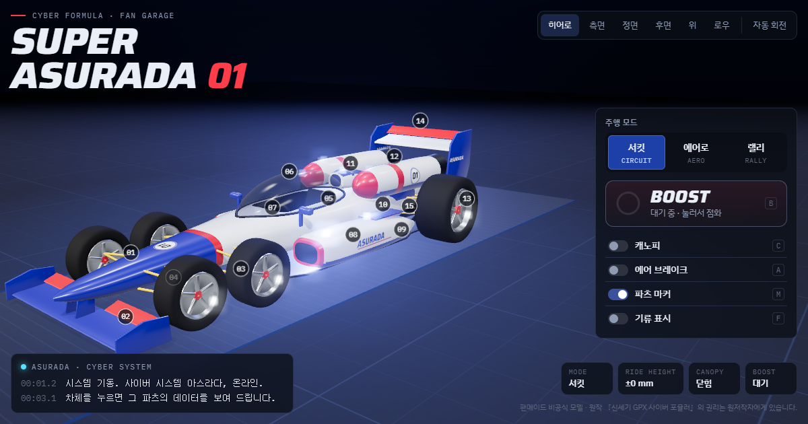

# Super Asurada 01 Garage

『신세기 GPX 사이버 포뮬러』의 슈퍼 아스라다 01을 브라우저에서 돌려 보는 팬메이드 3D 뷰어입니다.
파츠를 누르면 설명이 나오고, 캐노피·에어 브레이크·부스트·주행 모드를 직접 조작할 수 있습니다.

**바로 보기 → https://jeiel85.github.io/cyber-formula/**



## 할 수 있는 것

| 기능 | 내용 |
| --- | --- |
| 파츠 설명 | 차체나 번호 마커(15개)를 누르면 설명 카드와 모델 치수가 나오고 카메라가 그 파츠로 이동합니다. |
| 주행 모드 | **서킷**(기본) · **에어로**(리어 윙과 프런트 플랩을 세우고 사이드 핀 전개, 차고 −20mm) · **랠리**(차고 +140mm, 윙을 눕힘) |
| 부스트 | 1.2초 충전 후 점화. 노즐 불꽃, 포드 후퇴, 바퀴와 롤링 로드 회전, 레인 라이트 점멸 |
| 캐노피 · 에어 브레이크 | 캐노피는 앞쪽 힌지로 들리고, 에어 브레이크 패널은 뒤쪽 힌지로 세워집니다. |
| 기류 표시 | 위에서 렌더한 높이 맵으로 풍동 스모크 라인이 차체를 타고 넘습니다. |
| 사이버 시스템 콘솔 | 조작할 때마다 AI 아스라다의 메시지가 뜨고, 대시보드 화면이 함께 반응합니다. |
| 카메라 | 히어로 · 측면 · 정면 · 후면 · 위 · 로우 프리셋과 자동 회전 |

키보드: `B` 부스트 · `C` 캐노피 · `A` 에어 브레이크 · `1` `2` `3` 모드 · `M` 마커 · `F` 기류 · `←` `→` 파츠 이동 · `Esc` 카드 닫기

주행(조작해서 달리기)은 아직 없습니다.

## 어떻게 만들었나

1. **Blender 절차적 모델링** — [`blender/build_asurada.py`](blender/build_asurada.py)가 단면 표를 보간한 로프트로 모노코크·사이드 포드·부스트 포드를 만들고, 익형을 돌출해 윙을, 회전체로 바퀴를 만듭니다. 콕핏은 불리언으로 파냅니다. 움직이는 파츠는 `piv_*` 피벗 노드 아래에 두고, 각 오브젝트의 커스텀 속성 `part`가 glTF extras로 나가 뷰어의 파츠 설명과 연결됩니다.
2. **glTF 내보내기** — 같은 스크립트가 GLB를 내보내 다시 불러와 비교(round trip)한 뒤, 버퍼를 내장한 glTF JSON(`web/asurada.gltf.json`)도 함께 씁니다.
3. **Three.js 뷰어** — [`web/app.js`](web/app.js)가 재질을 이름별로 다시 입히고(클리어코트 도장, 유리, 발광체), 서스펜션 암·부스트 불꽃·데칼·기류 선을 런타임에 만듭니다. 호버/선택 윤곽선과 발광체 전용 블룸을 씁니다.

## 폴더 구조

```
blender/build_asurada.py   차체 생성 스크립트 (Blender 5.2)
blender/asurada.blend      생성된 Blender 파일
blender/asurada.glb        생성된 GLB
web/index.html             뷰어 화면 (문서 뼈대 없는 본문 조각)
web/app.js                 뷰어 로직
web/asurada.gltf.json      뷰어가 읽는 모델 (버퍼 내장 glTF)
tools/serve.mjs            로컬 미리보기 서버 (의존성 없음)
tools/build-pages.mjs      GitHub Pages용 dist/ 빌드
tools/page-shell.mjs       index.html에 문서 뼈대를 씌우는 공용 함수
assets/og.png              공유 미리보기 이미지 (1200×630)
```

`web/index.html`은 claude.ai 아티팩트에도 그대로 올릴 수 있도록 `<!doctype>`·`<head>` 없이 본문만 둡니다. 로컬 서버와 Pages 빌드가 같은 뼈대를 씌웁니다.

## 로컬에서 실행

Node.js 18 이상이면 됩니다. 설치할 패키지는 없습니다.

```bash
node tools/serve.mjs
```

http://localhost:8420 을 엽니다. 파일을 직접(`file://`) 열면 모델을 불러오지 못합니다.

## 모델 다시 만들기

```bash
"C:/Program Files/Blender Foundation/Blender 5.2/blender.exe" -b --factory-startup --python-exit-code 1 -P blender/build_asurada.py -- --glb blender/asurada.glb --web web/asurada.gltf.json --blend blender/asurada.blend --preview preview.png
```

`--preview`를 주면 네 방향 미리보기 시트를 저장합니다. 출력의 `AUDIT_ERRORS`에 바퀴 메시 18개가 "floating"으로 나오는 것은 정상입니다. 서스펜션 암을 뷰어가 런타임에 그리기 때문입니다.

## 배포

`main`에 푸시하면 [`.github/workflows/pages.yml`](.github/workflows/pages.yml)이 `node tools/build-pages.mjs`로 `dist/`를 만들어 GitHub Pages에 올립니다. 빌드가 공유 미리보기용 `og:image`에 Pages 주소를 절대 경로로 넣습니다.

## 알려 두기

팬이 만든 비공식 모델입니다. 『신세기 GPX 사이버 포뮬러』와 아스라다의 권리는 원저작자에게 있습니다. 리버리와 파츠 설명의 기계적 세부(작동 각도, 치수 등)는 이 모델을 위해 지은 설정이며 원작 설정과 다를 수 있습니다.
